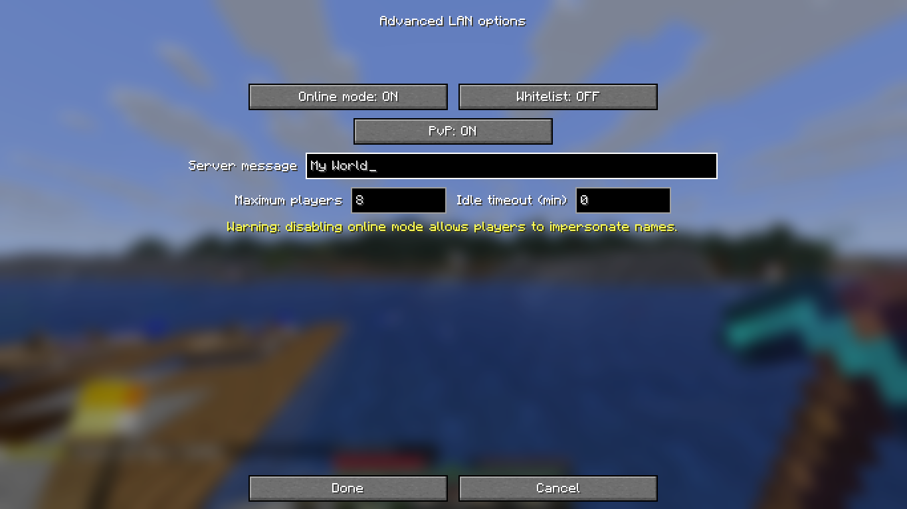

# LAN Server Options

Advanced LAN settings for Minecraft Java `26.2` on Fabric.



## Features

- Toggle `online-mode` from the LAN menu.
- Toggle the whitelist flag.
- Toggle PvP.
- Change the server MOTD shown in LAN discovery.
- Change the maximum player count from `1` to `100`.
- Change the idle timeout from `0` to `1440` minutes.
- Uses Minecraft `26.2`'s built-in LAN, port, game mode, and command permission controls.

## Requirements

- Minecraft Java `26.2`
- Fabric Loader `0.19.3` or newer for `26.2`
- Java `25`

Fabric API is not required.

## Installation

1. Download `lan-server-options-1.0.1.jar` from the releases page.
2. Put the JAR in the host client's `mods` folder.
3. Open a single-player world, pause, and use **Multiplayer Options** > **Advanced options**.

Only the player hosting the LAN world needs the mod. Joining players can use vanilla Minecraft `26.2`.

## Build From Source

```powershell
.\gradlew.bat build
```

The compiled JAR is created in `build/libs/`.

## Security Note

Disabling `online-mode` turns off account verification. Use it only on trusted networks because other players can impersonate usernames.

## License

CC0-1.0
